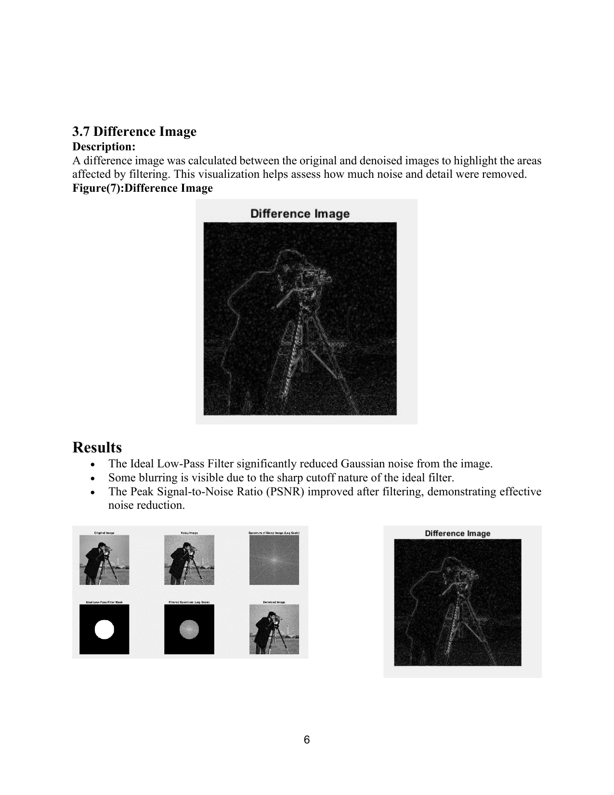
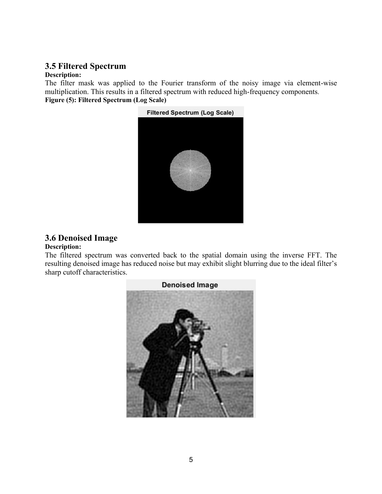

# Image Denoising in the Frequency Domain

[](matlab/frequency_domain_denoising.m)
[](#workflow)

> A MATLAB implementation of frequency-domain image denoising using a 2D FFT and circular Ideal Low-Pass Filter (ILPF).



## Overview

The project adds Gaussian noise to `cameraman.tif`, analyzes the spectrum, applies a circular Ideal Low-Pass Filter, reconstructs through inverse FFT, and measures quality with PSNR.

## Workflow

```text
Clean image -> Gaussian noise -> 2D FFT -> fftshift -> circular ILPF mask
                                                     |
                                 inverse FFT <- filtered spectrum
                                                     |
                                              Denoised image + PSNR
```



## Technical details

| Parameter | Default value |
| --- | ---: |
| Noise model | Additive Gaussian noise |
| Noise standard deviation | 20 |
| Filter | Circular Ideal Low-Pass Filter |
| Cutoff radius | 50 pixels |
| Evaluation | PSNR and visual difference image |

## Run

1. Open MATLAB and set the repository root as the working directory.
2. Run `matlab/frequency_domain_denoising.m`.
3. Review the original, noisy, spectrum, mask, reconstructed, and difference images.

## Engineering note

An ideal low-pass filter suppresses high-frequency noise, but its sharp cutoff may blur detail and introduce ringing. Gaussian or Butterworth filters are typically preferred when smoother transitions are needed.

## Context

Academic Digital Signal Processing laboratory project by Yahya Al Afifi and teammates, Islamic University of Gaza.
